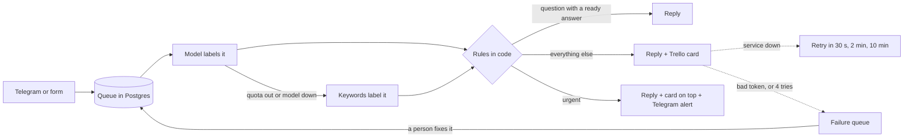

# Support triage workflow

Customer messages arrive by Telegram or a web form, a model labels them, and code decides what happens: answer on its own, open a Trello card for the team, or alert someone right away. When a service fails, the message waits and tries again, and what cannot be fixed by waiting goes to a failure queue for a person.

Project 9 of a 12-project AI engineering track focused on front-end. Built twice: in TypeScript, live and tested, and as an [n8n workflow](n8n/), to compare the two. The interface is in Portuguese. The store is fictional.

## How a message flows



## The model labels, code decides

The model returns one thing per message: a category, an urgency flag and, for questions, which ready answer fits. That is one model call per message. Everything after it is code:

- **Only a question with a ready answer is answered automatically.** Every other message reaches a person.
- **No generated sentence reaches the customer.** Replies are templates or answers written by people, so there is nothing for a model to invent.
- **Some words always make a message urgent,** such as "Procon", "advogado" or "fraude", whatever the model said. Missing an urgent case costs more than a false alarm.

## Does it work?

30 messages labeled before the first run ([cases](eval/cases.json), [results](eval/results.json)), including sarcasm, typos, two subjects in one message and three prompt injections:

| | Model | Keywords only |
| --- | --- | --- |
| Routed correctly | **30 of 30** | 23 of 30 |
| Category right | 30 of 30 | 20 of 30 |
| Urgent cases caught | 7 of 7 | 5 of 7 |
| Ready answer sent to someone with a real problem | 0 | 3 |
| Cost and latency | 1 call, median 1.1 s | free, instant |

**What the score hides:**

- **The rule in code did real work.** The model attached a ready answer to 7 messages that were not questions, such as "cadê meu pedido???", which it tagged with the tracking answer. The routing rule ignores that field unless the message is a question, so all 7 reached a person. Had the model decided, 7 customers with a problem would have received a canned reply.
- **The tail is slow.** The median was 1.1 s, but 1 call in 10 took over 17 s: the cheapest model sometimes never answers, and the fallback waits 15 s before moving to the next. The customer is not waiting on screen, because replies come from the queue, but a chat would feel it.
- **30 cases is small,** and the person who wrote the prompt also wrote the cases. The keyword rules were written before the cases and were not tuned to them afterwards.

## Built for failure

- **Answer fast, work later.** Telegram resends a message if it does not get a reply in time, so the webhook only stores it and answers. A unique `update_id` makes a resend harmless.
- **A retry redoes only what failed.** Each finished step is recorded. If the Trello card fails, the retry does not answer the customer again or call the model again.
- **Transient and permanent failures differ.** A timeout or a 503 waits 30 s, 2 min, then 10 min. A rejected token goes straight to the failure queue, because retrying cannot fix it.
- **No duplicate cards.** Trello has no idempotency key, so before creating a card the code looks for one carrying the message's marker.
- **Crashes are recovered.** A message taken by a run that died is picked up again once its lock expires. `FOR UPDATE SKIP LOCKED` keeps two runs from taking the same one.
- **Degrade instead of stopping.** If the model fails or the daily quota is used up, keywords label the message. The triage gets worse, measurably, but the customer still gets an answer.

## Code or n8n?

The same triage runs as an [n8n workflow](n8n/support-triage.json), calling the app for the classification, so both versions follow the same rules. Both were run locally. In this setup:

| | TypeScript (this app) | n8n |
| --- | --- | --- |
| Waits between retries | 30 s, 2 min, 10 min | at most 5 tries, at most 5 s apart, inside one run (limits in n8n's source) |
| A rejected token (401) | straight to the failure queue | retried 5 times like any error |
| When Trello fails, the customer | was already answered | waited 33 s and got an HTTP 500 |
| Failed messages | kept in a queue a person can send back | an error workflow alerts the team |
| Tests | 29, offline, in CI | none: checked by running it |
| Runs on | Vercel's free plan | your machine, or a paid or self-hosted server |

**Where n8n wins:** someone who does not code can read and change the flow, credentials live in one place, there are hundreds of ready integrations, and every run shows each node's input and output. The n8n version could do more of what the app does, with code nodes and a database, but then the logic lives in code anyway, without tests or readable diffs. For a workflow that a team changes often and that tolerates simple retries, n8n is the faster choice. For one that must not answer twice or lose a message, code was easier to make correct and to prove.

## Decisions

- **A workflow, not an agent.** The steps are known in advance, so a fixed order is cheaper, predictable and testable. The model is used for the one thing rules do badly: reading what the customer meant.
- **Postgres as the queue.** A table with a status, attempts and a next-attempt time is enough at this volume, and it is the same database that stores the steps.
- **No always-on worker.** Vercel's free plan has none, so the queue moves after each new message, while the panel is open and every 10 minutes from a GitHub Actions schedule. Production would use a real worker or a queue service.
- **Channels are optional.** Without Telegram or Trello keys, replies, cards and alerts are simulated and recorded, so the project runs with only a Gemini key.

## Limits

- **At least once on Telegram.** If the process dies between sending a reply and recording it, the customer may get it twice. Trello is protected; Telegram has no way to check.
- **The panel is public.** Anyone with the link sees the messages, which are deleted after 7 days. Production would need login.
- **Limits per IP are kept in memory,** per server instance. The daily caps are in the database.
- **Scheduled runs can be late.** GitHub may delay or skip scheduled workflows, and disables them after 60 days without activity in the repository.

## Run it

Requires Node 22 or later and a free [Gemini API key](https://aistudio.google.com/apikey). No database setup is needed locally.

```bash
npm install
cp .env.example .env.local   # add GEMINI_API_KEY
npm run dev
```

```bash
npm test                    # offline: fake model and channels, the real queue on an in-memory Postgres
npm run eval -- --keywords  # scores keywords and saved model runs, no quota
npm run eval                # real model on 30 messages, spends quota
```

To use real channels, add a Telegram bot from [@BotFather](https://t.me/BotFather) and a Trello API key and token to `.env.local`, then:

```bash
npm run setup:trello -- lists                            # pick TRELLO_LIST_ID
npm run setup:telegram -- chats                          # pick TELEGRAM_OPS_CHAT_ID
npm run setup:telegram -- webhook https://your-site.app  # after deploying
```

## Built with AI

Written with a coding agent. [`docs/AI-LOG.md`](docs/AI-LOG.md) records what it got wrong, and [`docs/CONCEITOS.md`](docs/CONCEITOS.md) is a study guide in Portuguese.

## License

MIT.
